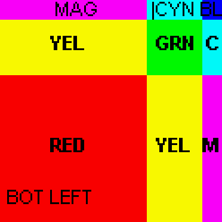

# 🖼️ image-editor - C++ Image Scaling Library

iamge-editor a lightweight C++ library for **editing and scaling image files**.  
It supports reading **24-bit BMP images**, resizing them using image scaling algorithms, and saving the results back to BMP format.

---

## 📖 About the Project

This project is a minimal, self-contained library for **image scaling** written in modern C++.  
It demonstrates core concepts of image processing, including:

- **Decoding BMP files** into raw pixel data (`BmpDecoder`).
- **In-memory image representation** with width, height, and RGB pixel buffer (`Image`).
- **Resizing algorithms** (nearest neighbor and bilinear interpolation) for scaling (`ImageScaler`).
- **Re-encoding BMP files** with proper headers and padding (`BmpEncoder`).

The library provides a **command-line interface** where the user supplies three arguments:

```bash
<program> <input_file.bmp> <output_file.bmp> <scale_factor>
```

Example:

```bash
./image_scaler input.bmp output.bmp 2
```

This doubles the size of `input.bmp` and writes the result to `output.bmp`.

---

## ⚙️ Implementation Details

### File Overview

- **`BmpDecoder.{h,cpp}`** – Handles reading BMP headers and extracting raw pixel data from 24-bit BMP images.
- **`BmpEncoder.{h,cpp}`** – Saves `Image` objects back into BMP format, handling padding and file size calculations.
- **`BmpHeader.h`** – Defines **bitmap headers** (`BitmapFileHeader` and `BitmapInfoHeader`) with proper byte alignment.
- **`Image.{h,cpp}`** – Represents an in-memory image with pixel data stored in a `std::vector<uint8_t>`.
- **`ImageScaler.{h,cpp}`** – Implements image scaling using:
  - **Nearest Neighbor** – Fast but may produce blocky results.
  - **Bilinear Interpolation** – Higher quality, smoother results (default).

### BMP Constraints
- Only **24-bit BMP** images are supported【13†source】.
- No compression (`BI_RGB` only).
- Row padding is properly handled on saving.

---

## 🚀 How to Build and Run

### Prerequisites
- A C++17 (or newer) compiler (GCC, Clang, MSVC).
- CMake (optional, if you want a build system).

### Build (using g++)
```bash
g++ -std=c++17 -O2 -o image_scaler     BmpDecoder.cpp BmpEncoder.cpp Image.cpp ImageScaler.cpp main.cpp
```

### Run
```bash
./image_scaler input.bmp output.bmp 2
```

This scales the input image by a factor of 2 and saves the result.

---

## 🧪 Example Usage

#### Input → Output (scale = 3)

| Input (124×124) | Output (372×372) |
|-----------------|------------------|
|  |  |


## ✨ Features

- ✅ Supports **loading and saving BMP** images.  
- ✅ Scaling via **nearest neighbor** or **bilinear interpolation**.  
- ✅ Lightweight, no external dependencies.  
- ✅ Modular design (easy to extend with other formats or filters).  

---

## 🔮 Future Improvements

- Add support for other formats (PNG, JPEG).  
- Implement more scaling filters (bicubic, Lanczos).  
- Add unit tests and benchmarks.  
- Provide Python bindings via PyBind11 for easy integration.  
